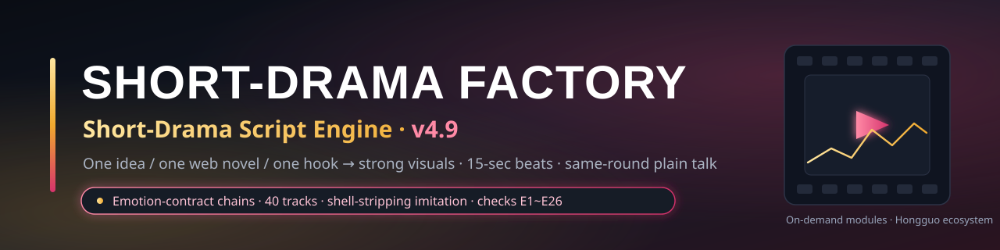

<p align="center">
<a href="#episode-length-tiers"></a>
<a href="#episode-length-tiers"></a>
<a href="#core-methodology"></a>
<a href="#capabilities"></a>
<a href="#structure"></a>
<a href="LICENSE"></a>
</p>

<h1 align="center">🎬 Short-Drama Factory v4.9</h1>
<p align="center"><b>Industrial screenwriting system for viral Douyin / Hongguo short dramas · Script-only engine (strong visuals · fast pacing · plain-language direct version)</b></p>

> **One creative prompt in, one viral script with a paywall out.**
> An emotion contract runs through the whole series, and conflicts run in units — a single conflict never drags past 30 episodes. Within each episode: a **four-beat, 15-second pivot**, **a strong visual `△` every 2–4 lines of dialogue**, and **evidence and conclusions stated in plain language in the same turn**. Length is selectable: standard / long (150–195 seconds, flexible) / manju (comic-drama). Dialogue, inner monologue, and narration run through three separate channels.
> Produces the script layer only; does not handle storyboards, assets, or video production.

---

## 🏆 Sponsors

Thanks to the following sponsors for supporting this project:

| LOGO | Type | Sponsor | Description | Website |
| --- | --- | --- | --- | --- |
|  | Company | OmniBoard | Zizi Animation's professional comic-drama creation tool, an all-in-one platform from script to distribution and monetization; annual plan for Seedance 2.5 as low as 0.19/second | [omniboard.tv/register?ref=GITHUBADD7DZ](https://omniboard.tv/register?ref=GITHUBADD7DZ) |
|  | Company | 浮瑞万相AI | Full-chain AI audiovisual service platform under 浮瑞万相AI, the operator of 喜马抓马: HimaStudio multimodal AI audiovisual creation platform and online OPC community · deeply integrated with the 漫剧老李 Skill | [himadrama.com](https://www.himadrama.com) |
|  | Company | 点众 | Open full IP library; super-creator access equals the company's in-house rights, with visibility into classic, viral, and premium-series IPs | [点众开放 IP 库](https://vcnti1p0lovd.feishu.cn/wiki/W3zvwKqzJiVRDqkvooEckIZgnFh) |
| *（LOGO placeholder）* | — | Open slot | Sponsorship slot open — get your product in front of many AI short-drama creators | [Contact us](mailto:lixiaoxiao9888@gmail.com) |

> 💡 **Sponsorship note**: sponsorship slots are open to model providers, compute platforms, API vendors, and creative teams.
> For partnerships, contact: email `lixiaoxiao9888@gmail.com` · WeChat `lisenlin998`

---

## Episode Length Tiers

| Tier | Episode length | Body size | Beats per episode | Season size options |
|---|---|---|---|---|
| Standard (default) | 90–120 seconds | 480–850 characters | 1 beat (includes the 15s four-stage progression) | 60 / 80 / 100 |
| **Long** | **150–195 seconds** | **820–1400 characters** | **Two round-trips + mid-episode hook** | **30 / 40 / 50** |
| Manju (comic-drama) | 60–90 seconds | 330–620 characters | 1 beat | 60 / 80 / 100 |

> Long tier is not padding: each episode must contain **two back-and-forth rounds** (pressure and rebuttal each escalate one level) + a **mid-episode hook at about 90 seconds**. Whole seasons are converted by content volume (1 long episode ≈ 2 standard episodes), and the four acts, unit chain, and paywall are converted in step.

---

## Core Methodology

1. **Emotion-contract unit chain** — the series is anchored on the "breath" viewers need to keep renewing each episode; conflicts are only the vehicle for each unit:
   - 🎯 **Hard cap: a single conflict must resolve within 20–30 episodes** (long tier halves this to 10–15 episodes; 60 episodes = 2–3 units / 80 = 3 / 100 = 3–4)
   - 🔄 **Three-seam conflict switching**: residue from the old unit seeds a new conflict (planted hooks) / the opponent changes layers but not desire / the character arc escalates with each unit — switching conflicts without losing momentum
   - 📊 **One round-trip table per unit**: a six-level evidence ladder × a six-level rebuttal-cost ladder; units hand off through the emotion contract
   - 💰 **Paywalls attach to unit seams**: a conflict switch is a natural strong paywall point; the midpoint attack/defense reversal lines up with the first paywall
2. **Three core rules for episode execution (new in v4.9 · targets talk-heavy radio-drama scripts and riddle-speaking dialogue)**:
   - 👀 **Three anchors for strong visual support**: every 2–4 lines of dialogue must include 1 strong visual `△` (physical spectacle with visible results / identity-contrast action / evidence reveal confrontation). No more than 6 consecutive pure-dialogue lines (`E24`). Ineffective micro-gestures such as "eyes flicker / leaned forward half an inch" are banned (`E26`).
   - ⚡ **Four-beat 15-second pivot table per episode**: `0~15s` hook and establish the stakes ➔ `15~45s` frontal confrontation ➔ `45~85s` card reveal and reversal (settles the episode) ➔ `85~110s` aftershock hook. Never spin in place within an episode.
   - 🗣️ **Plain language delivered in the same turn + fast/slow rhythm**: evidence identification and the plain-language conclusion must be delivered in the same turn. Technical jargon and setting-speak are converted to money / life / status consequences (`E25`). Short, punchy lines of `3~6` characters alternate with calculation lines of `8~16` characters.

---

## Capabilities

### 🧭 Project Setup & Structure

| Capability | In one line | Document |
|---|---|---|
| **Genre routing** | At setup, classify as emotion-flow vs. plot-flow; route to the contract unit chain or the information ladder | `emotion-flow-roundtrip.md` |
| **Three length tiers + 15-second pivots** | Standard / flexible long / manju formats; **15-second four-beat pivot table per episode** + duration-conservation gates (E16/E17) + 15-second window ≤95 characters (E19) | `hongguo-beat-sheet.md` |
| **First-three-episodes beat card** | E1 victimhood + stance → E2 evidence replay → E3 escalation; four rhythm types: diminishing / fluctuating / V-shape / micro-episode | `first-three-eps-beat-card.md` |
| **Character bible** | Four pillars: desire / secret / arc / language fingerprint + function-slot quotas; built before the outline | `character-bible.md` |

### 🏭 Production Pipeline

| Capability | In one line | Document |
|---|---|---|
| **Web-novel adaptation pipeline** | Extract → merge/cut → chapter-to-episode mapping → round-ification → system intake | `webnovel-adaptation.md` |
| **Shell-stripping imitation + 40 tracks** | **Three-layer method for imitating the spirit, not the form (strip the outer-shell blacklist → distill the dramatic formula → re-skin in three steps)**; full 40-track map (male 12 / female 14 / neutral 14) | `mechanism-imitation.md` · `genre-map.md` |
| **Cross-episode continuity ledger + A~I twists** | Four ledgers: foreshadowing / characters / props / rules; tiered hot/cold; nine twist types A~I in a rotation matrix (no reuse within 3 adjacent episodes; S8 machine check) | `continuity-ledger.md` · `ledger.md` |
| **Dramatic craft + seven-dimension plain-language dialogue** | Three visual anchors / cause-and-effect chains / seven questions per scene; **seven dimensions of dialogue (including same-turn evidence conclusions, jargon converted to plain language, fast/slow rhythm)**; controlled rules for inner monologue and narration | `craft-quality-layer.md` · `dialogue-doctor-anti-ai.md` · `inner-monologue-vo.md` |

### 🛡️ Quality Gates

| Capability | In one line | Document |
|---|---|---|
| **Machine-checked red lines** | Per-episode tiered checks **E1~E26** (volume / cliffhangers / duration conservation / 15-second window / talk-heavy break E24 / riddle-jargon E25 / ineffective micro-gestures E26 / compliance red lines…) + whole-series ledger checks **S1~S8**, all with self-tests | `scripts/` |
| **Review issue cards + protective counterexamples** | Reviewer / repair-operator dual roles, P0/P1/P2 grading, no total score, no hit prediction; NOTE-level counterexamples prevent false positives on quiet scenes and direct speech | `script-doctor-protocol.md` · `protective-counterexamples.md` |

> ⚡ **Dynamic on-demand loading matrix**: 8 interaction modes × only the core files they need, to prevent context blow-up (lazy loading).

---

## Interaction Modes (8)

`/project-outline` · `/series-outline` · `/long-outline 40` · `/episode-plan` · `/write-episode N` · `/write-long N` · `/script-doctor` · `/rapid-drama` · `/compliance-check` · `/serial-write N-M`

---

## Quick Start

```bash
# After installing into your skills directory, just talk to it: "write a short drama" · "setup: The Dragon King's Token" · "/long-outline 40" · "/serial-write 1-5"
# Commands use python on Windows; use python3 on macOS / Linux
python scripts/validate_episode.py --self-test
python scripts/validate_episode.py examples/ep01-longwang-demo.md --format standard
python scripts/validate_episode.py examples/long-format-3min-demo.md --format long
python scripts/validate_series.py --self-test
```

---

## Structure

```text
short-drama-factory/
├── SKILL.md                    # Entry point: tier table + genre/tier two-gate check + 8 modes + 10 red lines + execution order
├── references/                 # 18 authoritative libraries (methodology / ledgers / adaptation / bible / shell-stripping imitation / genres / hooks / cliffhangers / compliance / craft / seven-dimension dialogue / monologue & narration / review / counterexamples / evaluation…)
├── templates/                  # Blank ledger + episode layout (standard/long dual templates + monologue quota table + visual/pivot/direct-speech cheat sheet)
├── scripts/                    # validate_episode.py (E1~E26) + validate_series.py (S1~S8)
└── examples/                   # ep01-longwang-demo.md · long-format-3min-demo.md (full-run benchmarks with 0 FAIL / 0 WARN)
```

<p align="center"><sub>MIT License · Script layer only · Automatic routing between emotion-flow / plot-flow · Built for the Hongguo paid ecosystem</sub></p>
